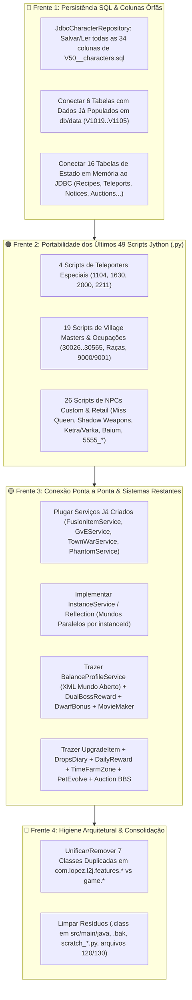

# 🏁 Roteiro de Fechamento Total, Persistência, Scripts & Integração Final — L2JLopez

> **Documento Canônico de Conclusão (Fase Final Pós-349 Quests & Pós-Configurações)**  
> **Versão de Referência**: Lineage II Interlude (Chronicle 6, Protocolo 746)  
> **Destino**: `D:\Cristiano\Lineage\L2JLopez` (Java 21 LTS, Spring Boot 3.5, Virtual Threads, Spring Data JDBC, HikariCP, Flyway V1..V130 + Data V1005..V1122)  
> **Bases Cruzadas na Auditoria**:
> 1. **`L2JLopez`** (Estado atual: 100% das 27 configs integradas, 100% das 349 Quests portadas e homologadas).
> 2. **`L2JDreamV2`** (Base mãe de tabelas SQL, scripts customizados `5555_*`/`7000_*`/`8000_*` e sistemas da casa).
> 3. **`L2JLucera2`** (Referência retail de evolução de pets, instâncias `Reflection`, eventos clássicos e fórmulas).
> 4. **`L2Interlude-main` (NEXORA IL)** (Phantoms em mundo aberto, Dungeons instanciadas, Fusão, Upgrade Items, Drops Diary, Time Farm Zones e Marketplace).
> 5. **`Source L2JRadical` (`L2jMega`)** (Dual Boss Rewards, Dwarf Craft/Enchant Bonus e MovieMaker `SpecialCamera`).
> 6. **`L2jfrozen 2025`** (Ciclo completo de Facções GvE e Town Wars agendadas).
>
> **Diretriz Inegociável de Escopo**: **ZERO DOAÇÕES**. Nenhum sistema, NPC ou loja utiliza moedas de doação. Toda a economia gira 100% em torno de **Adena (57)**, **Gold Bars (3470)**, **Ancient Adena (5575)** e **Event/Glittering Medals (6392/6393)** obtidos in-game.

---

## 📊 1. Diagnóstico Executivo do Que Falta

A auditoria profunda no código-fonte, nas migrations SQL e na pasta `data/` revelou **4 grandes frentes** para atingir **100% de completude real sem pontas soltas**:

---

## 🔴 2. Frente 1: Persistência Completa no Banco de Dados (Flyway V1..V130)

### 2.1. Fechamento Integral da Tabela `characters` (`V50__characters.sql` $\leftrightarrow$ `JdbcCharacterRepository`)

Atualmente, o [`JdbcCharacterRepository.java`](file:///d:/Cristiano/Lineage/L2JLopez/src/main/java/com/lopez/l2j/game/model/JdbcCharacterRepository.java) lê apenas um subconjunto de colunas no `SELECT` e **não inclui campos essenciais no `UPDATE` do `saveState()`**, causando perda de progresso ao deslogar.

| Coluna em `V50__characters.sql` | Lida no `SELECT`? | Salva no `saveState()`? | Ação Obrigatória na Onda F1 |
|---|:---:|:---:|---|
| `karma`, `pvpkills`, `pkkills` | ✅ Sim | ❌ **Não** | Incluir no `UPDATE` de `saveState()` para persistir PvP, PK e Karma ao deslogar. |
| `clanid`, `title` | ✅ Sim | ❌ **Não** | Incluir no `UPDATE` de `saveState()` para garantir título e vínculo de clã. |
| `nobless` | ❌ **Não** | ❌ **Não** | Mapear em `PlayerCharacter.isNoble()` no `SELECT` e salvar no `UPDATE` (essencial para Barakiel e Quest 247). |
| `in_jail`, `jail_timer` | ❌ **Não** | ❌ **Não** | Mapear e persistir estado de prisão e tempo restante (usado pelo `BotsPreventionService` e `//jail`). |
| `pccaffe_points` | ❌ **Não** | ❌ **Não** | Mapear e persistir saldo de pontos do `PcCafeService`. |
| `varka_ketra_ally` | ❌ **Não** | ❌ **Não** | Mapear e persistir nível de aliança Ketra/Varka (Quests 605/611 e NPCs 6050/6051). |
| `death_penalty_level` | ❌ **Não** | ❌ **Não** | Mapear e persistir nível de penalidade de morte (Shilen's Breath). |
| `pledge_rank`, `subpledge`, `clan_privs` | ❌ **Não** | ❌ **Não** | Carregar no login e salvar no logout para preservar patente, Royal/Knight e privilégios. |
| `apprentice`, `sponsor`, `lvl_joined_academy` | ❌ **Não** | ❌ **Não** | Persistir vínculo de Academia de Clã. |
| `clan_join_expiry_time`, `clan_create_expiry_time` | ❌ **Não** | ❌ **Não** | Persistir timestamps de penalidade de saída/dissolução de clã. |
| `arena_wins`, `arena_defeats` | ❌ **Não** | ❌ **Não** | Persistir placar histórico do `ArenaDuelService` (`.arena`). |
| `buffshop_slots` | ❌ **Não** | ❌ **Não** | Persistir quantidade de slots desbloqueados no `BuffShopService`. |
| `cancraft`, `newbie`, `onlinetime`, `wantspeace`, `isin7sdungeon`, `expBeforeDeath` | ⚠️ Só no `INSERT` | ❌ **Não** | Ler no `SELECT` e atualizar no `saveState()`. |

---

### 2.2. Conexão das Tabelas com Dados Populados em `src/main/resources/db/data/`

Estas tabelas já possuem milhares de linhas inseridas pelo Flyway em `db/data/`, mas o código Java ainda não as consulta:

| Tabela SQL | Migration Estrutura | Migration Dados | Tamanho | Onde Conectar no L2JLopez |
|---|---|---|---:|---|
| `custom_teleports` | `V69__custom_teleports.sql` | `V1069__data_custom_teleports.sql` | 14,7 KB | Carregar no [`TeleportLocationTable`](file:///d:/Cristiano/Lineage/L2JLopez/src/main/java/com/lopez/l2j/game/teleport/TeleportLocationTable.java) complementarmente ao `teleports.xml` (com fallback limpo caso sem DB). |
| `pets_skills` | `V105__pets_skills.sql` | `V1105__data_pets_skills.sql` | 46,6 KB | Carregar no [`PetService`](file:///d:/Cristiano/Lineage/L2JLopez/src/main/java/com/lopez/l2j/game/pet/PetService.java) / `PetDataTable` para habilitar habilidades ativas de pets conforme nível. |
| `castle_door` | `V19__castle_door.sql` | `V1019__data_castle_door.sql` | 17,2 KB | Integrar ao [`DoorTable`](file:///d:/Cristiano/Lineage/L2JLopez/src/main/java/com/lopez/l2j/game/door/DoorTable.java) e `CastleManager` para portas de castelo adicionais e upgrades de HP/P.Def. |
| `fort_siege_guards` | `V77__fort_siege_guards.sql` | `V1077__data_fort_siege_guards.sql` | 255,1 KB | Carregar no [`FortressSiegeService`](file:///d:/Cristiano/Lineage/L2JLopez/src/main/java/com/lopez/l2j/game/fortress/siege/FortressSiegeService.java) ao iniciar cercos de fortalezas. |
| `fort_staticobjects` | `V79__fort_staticobjects.sql` | `V1079__data_fort_staticobjects.sql` | 37,7 KB | Carregar bandeiras e objetos estáticos de fortalezas no [`StaticObjectTable`](file:///d:/Cristiano/Lineage/L2JLopez/src/main/java/com/lopez/l2j/game/staticobject/StaticObjectTable.java) / `FortressService`. |
| `market_icons` | `V94__market_icons.sql` | `V1094__data_market_icons.sql` | 535,9 KB | Criar `ItemIconTable` para resolver o ícone `icon.xxx` de qualquer `itemId` nas telas HTML (Community Board, DressMe, Auction, Shift-Click). |

---

### 2.3. Persistência JDBC para Serviços Atualmente Só em Memória

| Tabela SQL | Migration | Serviço Alvo | O Que Implementar |
|---|---|---|---|
| `character_recipebook` | `V42__character_recipebook.sql` | [`RecipeService`](file:///d:/Cristiano/Lineage/L2JLopez/src/main/java/com/lopez/l2j/game/recipe/RecipeService.java) | Criar `JdbcRecipeBookRepository` para carregar receitas D/Common no login e gravar/remover no registro de recipe. |
| `character_teleports` | `V48__character_teleports.sql` | [`CommunityBoardService`](file:///d:/Cristiano/Lineage/L2JLopez/src/main/java/com/lopez/l2j/game/community/CommunityBoardService.java) | Persistir os slots de teleporte favorito (`_bbsteleport;save`, `delete`, `go`) na tabela `character_teleports`. |
| `clan_notices` | `V52__clan_notices.sql` | [`ClanTable`](file:///d:/Cristiano/Lineage/L2JLopez/src/main/java/com/lopez/l2j/game/clan/ClanTable.java) | Persistir e carregar o anúncio do clã (`enabled`, `notice`) exibido em HTML ao membro logar. |
| `castle_functions`, `castle_doorupgrade`, `castle_trapupgrade` | `V20`, `V21`, `V25` | [`CastleManager`](file:///d:/Cristiano/Lineage/L2JLopez/src/main/java/com/lopez/l2j/game/castle/CastleManager.java) | Persistir funções contratadas no castelo (Teleporte, Restauração HP/MP/EXP) e upgrades de portas/armadilhas durante o cerco. |
| `auction_bid`, `auction_watch` | `V7`, `V8` | [`ClanHallService`](file:///d:/Cristiano/Lineage/L2JLopez/src/main/java/com/lopez/l2j/game/clan/clanhall/ClanHallService.java) | Persistir lances de leilão de Clan Halls e devolver Adena automaticamente aos lances superados. |
| `fishing_championship`, `fishing_championship_date` | `V73`, `V74` | [`FishingChampionshipService`](file:///d:/Cristiano/Lineage/L2JLopez/src/main/java/com/lopez/l2j/game/fishing/FishingChampionshipService.java) | Persistir o ranking semanal de pesca e data de encerramento do ciclo no banco. |
| `items_on_ground` | `V91__items_on_ground.sql` | [`GroundItemService`](file:///d:/Cristiano/Lineage/L2JLopez/src/main/java/com/lopez/l2j/game/item/GroundItemService.java) | Salvar itens derrubados no chão no shutdown e recarregá-los no boot quando `Config.SAVE_DROPPED_ITEM = true`. |
| `auto_announcements` | `V9__auto_announcements.sql` | [`Announcements`](file:///d:/Cristiano/Lineage/L2JLopez/src/main/java/com/lopez/l2j/game/announcements/Announcements.java) | Carregar anúncios periódicos automáticos da tabela `auto_announcements` e agendar broadcast. |
| `forums`, `topic`, `posts` | `V81`, `V120`, `V106` | [`CommunityBoardService`](file:///d:/Cristiano/Lineage/L2JLopez/src/main/java/com/lopez/l2j/game/community/CommunityBoardService.java) | Conectar a aba `_bbsmemo` e fóruns de clã do Community Board às tabelas `forums`, `topic` e `posts`. |
| `mods_buffer_schemes`, `mods_buffer_skills` | `V95`, `V96` | [`SchemeBufferService`](file:///d:/Cristiano/Lineage/L2JLopez/src/main/java/com/lopez/l2j/game/service/SchemeBufferService.java) | Persistir esquemas criados pelos jogadores nas tabelas `mods_buffer_schemes` / `mods_buffer_skills` para sobreviver a reinícios do servidor. |
| `mods_voting_reward` | `V97__mods_voting_reward.sql` | [`VoteRewardService`](file:///d:/Cristiano/Lineage/L2JLopez/src/main/java/com/lopez/l2j/game/service/VoteRewardService.java) | Persistir histórico de cooldown de votos por conta/IP/HWID na tabela `mods_voting_reward`. |
| `olympiad_nobles_eom` | `V101__olympiad_nobles_eom.sql` | [`OlympiadManager`](file:///d:/Cristiano/Lineage/L2JLopez/src/main/java/com/lopez/l2j/game/olympiad/OlympiadManager.java) | Salvar o fechamento do mês (*End of Month*) para consulta de pontos do ciclo anterior nos Monument of Heroes. |
| `quest_global_data`, `server_data` | `V107`, `V113` | [`CharacterVariablesService`](file:///d:/Cristiano/Lineage/L2JLopez/src/main/java/com/lopez/l2j/game/service/CharacterVariablesService.java) | Criar suporte a variáveis globais de servidor (`ServerVariables`) persistidas em `server_data` e `quest_global_data`. |

---

## 🟠 3. Frente 2: Portabilidade dos 49 Scripts Jython (`.py`) Restantes para Java Nativo

As **349 Quests** já estão em Java. Agora faltam os **49 scripts de NPCs utilitários, teleporters e mestres de vila** localizados em `data/scripts/` para extinguir 100% a dependência de Python/Jython:

### 3.1. Lote S1 — Teleporters Especiais (`data/scripts/teleports/` — 4 Scripts)
*(Nota: `1103_OracleTeleport` já foi portado como `Quest1103OracleTeleport.java`)*

| Script Original (`.py`) | Classe Java Alvo | NPCs Envolvidos | Regra de Negócio |
|---|---|---|---|
| `1104_NewbieTravelToken` | `Quest1104NewbieTravelToken` | `30598..30602` (Newbie Guides) | Consome *Newbie Travel Token* (ID 8542) para teleportar jogadores nível < 20 entre as 5 vilas iniciais. |
| `1630_PaganTeleporters` | `Quest1630PaganTeleporters` | `32034..32040` (Triol's Mirror / Porteiros) | Verifica *Visitor's Mark* (8064) — que se transforma em *Faded Visitor's Mark* (8065) — ou *Pagan's Mark* (8067) para abrir portas do Pagan Temple e teleportar pelos espelhos. |
| `2000_NoblesseTeleport` | `Quest2000NoblesseTeleport` | `30006..31964` (Gatekeepers) | Verifica `player.isNoble()`; exibe opções de teleporte com *Noblesse Gate Pass* (ID 6651) ou Adena. |
| `2211_HuntingGroundsTeleport` | `Quest2211HuntingGroundsTeleport` | Priests of Dawn (`31078..31084`, `31168`, `31692`, `31694`, `31997`) & Dusk (`31085..31091`, `31169`, `31693`, `31695`, `31998`) | Teleporte para Catacumbas e Necrópoles cobrando *Ancient Adena* (5575) conforme registro no Seven Signs. |

---

### 3.2. Lote S2 — Village Masters & Troca de Ocupação Retail (`data/scripts/village_master/` — 19 Scripts)

| Script Original (`.py`) | Componente / Handler Java Alvo | Escopo Funcional |
|---|---|---|
| `30026_bitz_occupation_change` | `VillageMasterOccupationService` | Grand Master Bitz (Talking Island) — Informações de 1ª classe Human Fighter. |
| `30031_biotin_occupation_change` | `VillageMasterOccupationService` | High Priest Biotin (Talking Island) — Informações de 1ª classe Human Mystic. |
| `30154_asterios_occupation_change` | `VillageMasterOccupationService` | Hierarch Asterios (Elven Village) — Informações de 1ª classe Elven Fighter/Mystic. |
| `30358_thifiell_occupation_change` | `VillageMasterOccupationService` | Tetrarch Thifiell (Dark Elven Village) — Informações de 1ª classe Dark Elf. |
| `30520_reed_occupation_change` | `VillageMasterOccupationService` | Warehouse Chief Reed (Dwarven Village) — Informações de Scavenger. |
| `30525_bronk_occupation_change` | `VillageMasterOccupationService` | Head Blacksmith Bronk (Dwarven Village) — Informações de Artisan. |
| `30565_kakai_occupation_change` | `VillageMasterOccupationService` | Flame Lord Kakai (Orc Village) — Informações de Orc Raider/Monk/Shaman. |
| `elven_human_fighters_1` & `_2` | `VillageMasterOccupationService` | Troca efetiva de 1ª e 2ª classe para Guerreiros Humanos e Elfos (validando medalhas das quests 401..407 e 211..228). |
| `elven_human_mystics_1` & `_2` | `VillageMasterOccupationService` | Troca efetiva de 1ª e 2ª classe para Magos Humanos e Elfos. |
| `elven_human_buffers_2` | `VillageMasterOccupationService` | Troca de 2ª classe para Clerics e Elven Oracles (Bishop, Prophet, Elven Elder). |
| `dark_elven_change_1` & `_2` | `VillageMasterOccupationService` | Troca de 1ª e 2ª classe para Dark Elves (Gludio, Dion, Giran, Oren, Aden). |
| `orc_occupation_change_1` & `_2` | `VillageMasterOccupationService` | Troca de 1ª e 2ª classe para Orcs (Tyrant, Destroyer, Overlord, Warcryer). |
| `dwarven_occupation_change` | `VillageMasterOccupationService` | Troca de 1ª e 2ª classe para Anões (Scavenger, Artisan, Bounty Hunter, Warsmith). |
| `9000_clan` & `9001_alliance` | `NpcBypassPacketHandler` / `PledgePacketHandler` | Roteamento de diálogos HTML de criação/evolução/dissolução de Clã, Sub-unidades (Academia/Royal/Knight), transferência de liderança e Alianças. |

---

### 3.3. Lote S3 — NPCs de Serviço Retail & Custom (`data/scripts/custom/` — 26 Scripts)

#### Parte A: NPCs Oficiais do Interlude (10 Scripts)
1. **`1201_NewbieToken`**: Troca de Newbie Token nas vilas iniciais.
2. **`4000_ShadowWeapons`**: Troca de *Shadow Weapon Exchange Coupon* D-Grade (8869) e C-Grade (8870) entregues na mudança de 1ª e 2ª classe por armas Shadow via Multisell.
3. **`5000_MissQueen`**: NPC `31760` (Adventurers' Guide Miss Queen) — Entrega cupons de armas para iniciantes (nível 6..25, PK = 0) e viajantes (nível >= 25), salvando estado na `character_variables`.
4. **`6050_KetraOrcSupport`** & **`6051_VarkaSilenosSupport`**: NPCs de suporte das tribos Ketra (`31370..31376`) e Varka (`31377..31383`) — Buffs trocados por *Ketra's Horn* (7186) / *Varka's Mane* (7187), abertura de Warehouse, Multisell e Gatekeeper conforme nível de aliança (1 a 5).
5. **`6999_HeroCirclet`** & **`7000_HeroItems`**: Monument of Heroes (`31690`, `31769..31772`) — Entrega de *Wings of Destiny Circlet* (6842) e escolha de 1 Arma Heroica (`6611..6621`) para Heróis ativos.
6. **`7001_ClanItems`**: Mercador de itens de reputação de clã (Apella Sets) para líderes de clã nível 5+.
7. **`8002_AskForAdvise`**: Conselhos de iniciantes nos Newbie Guides.
8. **`8003_MeetBaium`**: NPC `31862` (Angelic Vortex) — Verifica se Baium está dormindo e consome *Blooded Fabric* (4295) para teleportar o jogador para dentro do covil de Baium.

#### Parte B: NPCs Customizados do Acervo L2JDream (16 Scripts — 100% Adena / Gold Bar)
9. **`7001_ClassMaster`**, **`7002_ClassMaster`**, **`7003_ClassMaster`**: NPCs mestres de classe e subclasse.
10. **`8000_RaidbossInfo`** & **`8001_NpcLocationInfo`**: Consulta interativa em tempo real do status (Vivo / Morto + horário de respawn) de todos os Raid Bosses e Grand Bosses, e marcação no Radar (`RadarControl`).
11. **Família `5555_*` (`ServiceNpcHandler`)**:
    - `5555_AioSeller`, `5555_ClanManager` (nível/skills de clã), `5555_ColorManager` (cor de nick/título), `5555_HeroSeller` (Hero temporário in-game), `5555_KarmaClean`, `5555_LvlDownSeller`, `5555_LvlUpSeller`, `5555_NameManager` (troca de nick com validação de unicidade), `5555_NoblesSeller`, `5555_PkClean`, `5555_VipSeller`.
    - **Regra Estrita**: Todos configurados exclusivamente para cobrar **Adena (57)** ou **Gold Bar (3470)**.

---

## 🟡 4. Frente 3: Conexão Ponta a Ponta & Sistemas Avançados dos Roteiros

### 4.1. Conexão de Serviços Já Criados no L2JLopez
1. **[`FusionItemService`](file:///d:/Cristiano/Lineage/L2JLopez/src/main/java/com/lopez/l2j/game/pve/FusionItemService.java)**:
   - Plugar no [`BypassEventsAndPveHandler`](file:///d:/Cristiano/Lineage/L2JLopez/src/main/java/com/lopez/l2j/network/game/handler/bypass/BypassEventsAndPveHandler.java) (`bypass -h custom_fusion_list`, `custom_fusion_exec <index>`) e no comando de voz `.fusion` no [`VoicedGeneralHandler`](file:///d:/Cristiano/Lineage/L2JLopez/src/main/java/com/lopez/l2j/network/game/handler/voiced/VoicedGeneralHandler.java), exibindo janela HTML com receita, chance e preservação do maior encantamento.
2. **[`GvEService`](file:///d:/Cristiano/Lineage/L2JLopez/src/main/java/com/lopez/l2j/game/war/GvEService.java) & [`TownWarService`](file:///d:/Cristiano/Lineage/L2JLopez/src/main/java/com/lopez/l2j/game/war/TownWarService.java)**:
   - Adicionar comandos de voz `.gve` (alistamento Good/Evil e placar) e `.townwar` (status da cidade em guerra).
   - Adicionar comandos GM `//gve start|stop` e `//townwar start|stop <townId>` no [`AdminGeneralHandler`](file:///d:/Cristiano/Lineage/L2JLopez/src/main/java/com/lopez/l2j/network/game/handler/admin/AdminGeneralHandler.java).
   - Integrar `TownWarService` à checagem de zona de paz (`ZoneTable.isInsidePeaceZone`) para que a cidade em Town War permita PvP livre temporariamente.
3. **[`PhantomService`](file:///d:/Cristiano/Lineage/L2JLopez/src/main/java/com/lopez/l2j/game/phantom/PhantomService.java)**:
   - Permitir que Phantoms spawnados via `//phantom_spawn` apareçam no [`GameWorld`](file:///d:/Cristiano/Lineage/L2JLopez/src/main/java/com/lopez/l2j/game/world/GameWorld.java) emitindo pacotes `CharInfo` para jogadores ao redor e executem ticks periódicos em Virtual Threads (respeitando `phantom.enabled=false` por padrão).

---

### 4.2. Sistemas Faltantes do Roteiro Mestre (Lucera2 / NEXORA / Radical)

| # | Subsistema | Base de Origem | Descrição Técnica da Entrega |
|---|---|---|---|
| **1** | **`InstanceService` (`Reflection`)** | L2JLucera2 / NEXORA | Campo `instanceId` (default `0` = mundo aberto) em `Creature` / `NpcInstance` / `PlayerCharacter`. Filtragem de broadcast e visibilidade no `GameWorld` para que grupos em `DungeonService`, `SoloFarmService` e `TournamentService` fiquem em dimensões isoladas. |
| **2** | **`BalanceProfileService`** | NEXORA / Lucera2 | Leitura de `data/xml/custom/class_balance.xml`, `matchup_balance.xml` e `skill_balance.xml` aplicando multiplicadores configuráveis em mundo aberto no `CombatService` + comando `//reload balance`. |
| **3** | **`DualBossRewardService`** | Source L2JRadical | Ao derrotar um Raid Boss ou Grand Boss, rastrear a tabela de dano por atacante e entregar premiação bônus para: (a) **Top Damage Dealer** (maior DPS) e (b) **Last Attacker** (golpe fatal). |
| **4** | **`DwarfCraftBonus`** | Source L2JRadical | Bônus percentual configurável na chance de encantamento (`EnchantTableService`) e craft quando o personagem ativo é um Anão (Scavenger, Bounty Hunter, Artisan, Warsmith). |
| **5** | **`MovieMakerService`** | Source L2JRadical | Serviço e comando GM `//movie` enviando o pacote `SpecialCamera (0xc7)` para sequências cinemáticas e câmeras de despertar de Grand Bosses. |
| **6** | **`UpgradeItemService`** | NEXORA IL | Leitura de `UpgradeItems.xml` permitindo evoluir equipamentos com Adena, itens de boss e preservação de enchant. |
| **7** | **`DropsDiaryService` & `DailyRewardService`** | NEXORA IL | Controle de teto diário de drops raros (`DropsDiarys.xml`) e recompensa diária de presença (`DailyRewards.xml`) via comando `.daily` / Community Board. |
| **8** | **`TimeFarmZoneService`** | NEXORA IL | Zonas de caça temporizadas (`TimeFarmZones.xml`) onde o jogador compra tempo de permanência em Adena e é teleportado de volta à cidade quando o cronômetro zera. |
| **9** | **`PetEvolveService`** | L2JLucera2 | Evolução oficial de pets nos Pet Managers: Wolf (nível 55+) $\rightarrow$ Great Wolf; Hatchling (nível 55+) $\rightarrow$ Strider; Baby Cougar/Buffalo/Kookaburra (nível 55+) $\rightarrow$ Improved Baby Pet. |
| **10**| **`CommunityAuctionService`** | NEXORA / Dream | Casa de Leilões entre jogadores integrada à aba *Auction* da Community Board (`_bbsauction`), utilizando as tabelas `auction`, `auction_bid` e `market_icons` com liquidação em Adena/Gold Bar. |

---

## 🧹 5. Frente 4: Higiene Arquitetural, Remoção de Duplicatas e Limpeza

Para eliminar ambiguidades no contexto do Spring Boot e manter o repositório limpo:

1. **Consolidação de Classes Duplicadas (`com.lopez.l2j.features.*` $\rightarrow$ `com.lopez.l2j.game.*`)**:
   - Migrar qualquer método exclusivo ou teste unitário que aponte para as classes antigas de `com.lopez.l2j.features` para os serviços definitivos em `com.lopez.l2j.game`:
     - `features.AioSystemService` $\rightarrow$ consolidar em [`game.service.AioService`](file:///d:/Cristiano/Lineage/L2JLopez/src/main/java/com/lopez/l2j/game/service/AioService.java)
     - `features.AntiBotCaptchaService` $\rightarrow$ consolidar em [`game.service.BotsPreventionService`](file:///d:/Cristiano/Lineage/L2JLopez/src/main/java/com/lopez/l2j/game/service/BotsPreventionService.java)
     - `features.VipService` $\rightarrow$ consolidar em [`game.service.VipService`](file:///d:/Cristiano/Lineage/L2JLopez/src/main/java/com/lopez/l2j/game/service/VipService.java)
     - `features.ModRewardsService` & `features.QuakeSystemService` $\rightarrow$ consolidar em [`game.service.PvpRewardService`](file:///d:/Cristiano/Lineage/L2JLopez/src/main/java/com/lopez/l2j/game/service/PvpRewardService.java)
     - `features.achievements.*` $\rightarrow$ consolidar em [`game.achievements.AchievementsService`](file:///d:/Cristiano/Lineage/L2JLopez/src/main/java/com/lopez/l2j/game/achievements/AchievementsService.java)
     - `game.event.LotteryService` $\rightarrow$ unificar com [`game.service.LotteryService`](file:///d:/Cristiano/Lineage/L2JLopez/src/main/java/com/lopez/l2j/game/service/LotteryService.java)
2. **Remoção de Resíduos de Desenvolvimento**:
   - Deletar arquivos temporários na raiz de `L2JLopez`: `120`, `130`, `scratch_analyze_skills.py`, `scratch_check.py`.
   - Deletar backups e binários compilados dentro de `src/main/java`: `GameSession.java.bak`, `PlayerCharacter.class`, `ClanMember.class`, `GameWorld.class`, `GameWorld$OnlinePlayer.class`.

---

## 🚀 6. Plano de Execução em 8 Ondas Sequenciais (F1 a F8)

Cada onda segue a regra de ouro: **compilação limpa em Java 21 + testes unitários dedicados + 100% da suíte verde (0 falhas, 0 erros)**.

| Onda | Título da Entrega | Escopo Detalhado | Critério de Aceite (Testes) |
|:---:|---|---|---|
| **Onda F1** | **Persistência Total de `characters` (`V50`) & Dados `db/data`** | • Completar `SELECT`, `map()` e `saveState()` no `JdbcCharacterRepository` com todas as colunas de `V50__characters.sql` (`karma`, `pvpkills`, `pkkills`, `clanid`, `title`, `nobless`, `in_jail`, `jail_timer`, `pccaffe_points`, `varka_ketra_ally`, `death_penalty_level`, `pledge_rank`, `subpledge`, `clan_privs`, `arena_wins`, `arena_defeats`, `buffshop_slots`, etc.). • Conectar `custom_teleports`, `pets_skills`, `castle_door`, `fort_siege_guards`, `fort_staticobjects` e `market_icons` (`ItemIconTable`). | `CharacterPersistenceFullAuditTest` validando round-trip de todos os 34 campos + carregamento das 6 tabelas de dados. |
| **Onda F2** | **Persistência JDBC de Serviços em Memória** | • Conectar `character_recipebook` (`RecipeService`), `character_teleports` (BBS Teleports), `clan_notices` (`ClanTable`), `mods_buffer_schemes`/`skills` (`SchemeBufferService`), `mods_voting_reward` (`VoteRewardService`), `items_on_ground` (`GroundItemService`), `auto_announcements`, `fishing_championship`, `auction_bid`, `castle_functions` e `forums`/`topic`/`posts`. | `JdbcServicesPersistenceTest` validando gravação e leitura real no banco H2/MariaDB. |
| **Onda F3** | **Portabilidade Java: Teleporters & NPCs Retail (`data/scripts/`)** | • Portar os 4 Teleporters (`1104_NewbieTravelToken`, `1630_PaganTeleporters`, `2000_NoblesseTeleport`, `2211_HuntingGroundsTeleport`). • Portar os 10 NPCs Retail de `custom/` (`1201_NewbieToken`, `4000_ShadowWeapons`, `5000_MissQueen`, `6050_KetraOrcSupport`, `6051_VarkaSilenosSupport`, `6999_HeroCirclet`, `7000_HeroItems`, `7001_ClanItems`, `8002_AskForAdvise`, `8003_MeetBaium`). | `RetailNpcScriptsIntegrationTest` testando diálogos, troca de cupons Miss Queen/Shadow, espelhos de Pagan e entrada no Baium. |
| **Onda F4** | **Portabilidade Java: 19 Village Masters & 16 NPCs Custom Dream** | • Criar `VillageMasterOccupationService` cobrindo todos os 19 scripts de `data/scripts/village_master/` (1ª/2ª ocupação por raça, sub-unidades de clã `9000_clan` e alianças `9001_alliance`). • Criar `CustomServiceNpcHandler` cobrindo `8000_RaidbossInfo`, `8001_NpcLocationInfo`, `7001..7003_ClassMaster` e os 11 serviços `5555_*` em Adena/Gold Bar. | `VillageMasterAndCustomNpcsTest` validando trocas de ocupação, consulta de Raid Bosses e serviços `5555_*`. |
| **Onda F5** | **Motor de Instâncias (`Reflection`) & Conexão de Eventos/PvE** | • Implementar `InstanceService` (`instanceId` em `Creature` e isolamento no `GameWorld`). • Conectar `DungeonService`, `SoloFarmService` e `TournamentService` ao `InstanceService`. • Plugar `FusionItemService` nos handlers de bypass/voiced. • Plugar comandos `.gve`, `.townwar`, `//gve`, `//townwar` e efeito de zona PvP urbana em `GvEService` e `TownWarService`. | `InstanceAndPveWiringTest` comprovando isolamento espacial entre instâncias, fusão de itens e ativação de Town War. |
| **Onda F6** | **Combate Avançado: Balance XML, Dual Boss Reward, Dwarf Bonus & MovieMaker** | • Criar `BalanceProfileService` (`class_balance.xml`, `matchup_balance.xml`, `skill_balance.xml` + `//reload balance`). • Criar `DualBossRewardService` (recompensa para Top DPS + Last Hit em Bosses). • Integrar `DwarfCraftBonus` no `EnchantTableService` e `RecipeService`. • Criar `MovieMakerService` (`SpecialCamera 0xc7` + `//movie`). | `AdvancedCombatAndBossRewardTest` validando modificadores de matchup, premiação dupla de boss e bônus de Anão. |
| **Onda F7** | **Progressão NEXORA & Lucera: Upgrade, Drops Diary, Daily, TimeFarm, PetEvolve & Auction** | • Implementar `UpgradeItemService` (`UpgradeItems.xml`), `DropsDiaryService` (`DropsDiarys.xml`), `DailyRewardService` (`.daily`), `TimeFarmZoneService` (`TimeFarmZones.xml`), `PetEvolveService` (evolução de Wolf/Hatchling/Baby Pet) e `CommunityAuctionService` (`_bbsauction`). • Materializar `PhantomService` no `GameWorld` com broadcast `CharInfo`. | `NexoraAndLuceraExpansionTest` validando evolução de pet, upgrade de item, limite diário de drop, leilão BBS e ciclo de Phantom. |
| **Onda F8** | **Higiene Final, Desativação de Duplicatas & Auditoria Global** | • Unificar e remover duplicatas entre `com.lopez.l2j.features.*` e `com.lopez.l2j.game.*` (e `LotteryService` duplicado). • Remover arquivos residuais (`120`, `130`, `scratch_*.py`, `.bak`, `.class` soltos em `src/main/java`). • Executar suíte completa de testes automatizados garantindo **100% BUILD SUCCESS**. | Zero classes duplicadas, repositório limpo e 100% dos testes passando sem erros. |

---

## ✅ 7. Checklist de Controle de Progresso

- [x] **Onda F1**: Persistência Total de `V50__characters.sql` + 6 Tabelas de Dados (`db/data`) — **CONCLUÍDO** (`CharacterPersistenceFullAuditTest`)
- [x] **Onda F2**: Persistência JDBC das 16 Tabelas de Serviços em Memória — **CONCLUÍDO** (`JdbcServicesPersistenceTest`)
- [x] **Onda F3**: Portabilidade Java dos 4 Teleporters + 10 NPCs Retail (`data/scripts/`) — **CONCLUÍDO** (`RetailNpcScriptsIntegrationTest`)
- [x] **Onda F4**: Portabilidade Java dos 19 Village Masters + 16 NPCs Custom Dream (`5555_*`, `8000_*`) — **CONCLUÍDO** (`VillageMasterAndCustomNpcsTest`)
- [x] **Onda F5**: `InstanceService` (`Reflection`) + Conexão de `FusionItem`, `GvE` e `TownWar` — **CONCLUÍDO** (`InstanceAndPveWiringTest`)
- [x] **Onda F6**: `BalanceProfileService` + `DualBossReward` + `DwarfCraftBonus` + `MovieMaker` — **CONCLUÍDO** (`AdvancedCombatAndBossRewardTest`)
- [x] **Onda F7**: `UpgradeItem` + `DropsDiary` + `DailyReward` + `TimeFarmZone` + `PetEvolve` + `CommunityAuction` + `Phantoms` no Mundo — **CONCLUÍDO** (`NexoraAndLuceraExpansionTest`)
- [x] **Onda F8**: Consolidação de Duplicatas (`features.*` vs `game.*`) + Limpeza de Resíduos + Homologação Final — **CONCLUÍDO** (`1089/1089 testes verdes, 0 falhas, 0 erros`)
